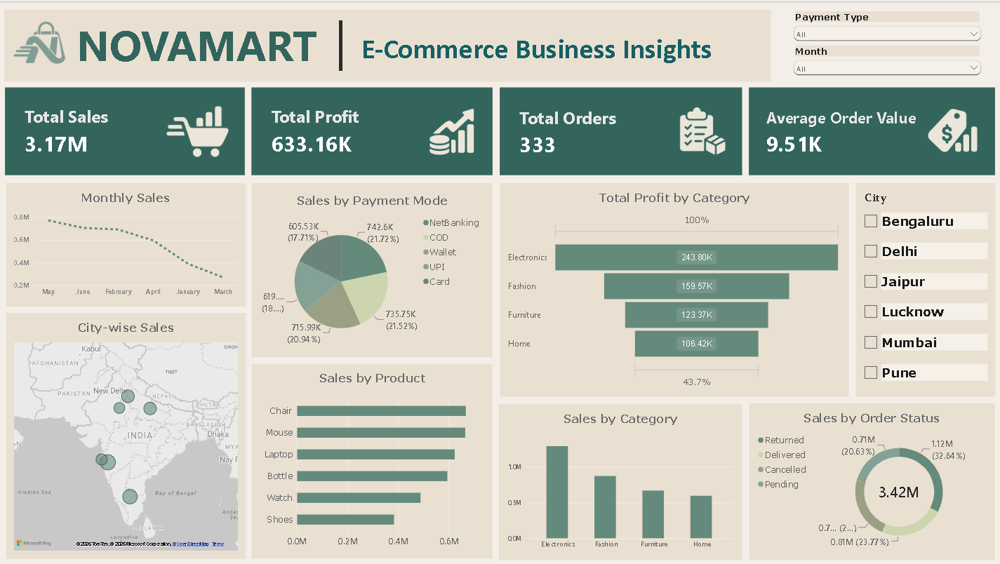

# 🛒 NOVAMART – E-Commerce Business Insights

### End-to-End E-Commerce Data Analytics Project

> **Transforming Raw E-Commerce Data into Meaningful Business Insights.**

---

## 📌 About the Project

**NOVAMART – E-Commerce Business Insights** is an end-to-end data analytics project based on a fictional e-commerce company. The project focuses on preparing, processing and analysing e-commerce data to make it suitable for business reporting and visualisation.

Using **Microsoft Excel, Python, MySQL and Power BI**, the project follows a structured workflow, starting with data preparation and cleaning, followed by data validation, feature engineering, database integration and dashboard development.

The final objective is to transform raw e-commerce data into a structured dataset and present business information through an interactive Power BI dashboard.

## 🎯 Project Objectives

- Prepare and organise raw e-commerce datasets.
- Perform data cleaning and handle data quality issues.
- Validate data for consistency and accuracy.
- Apply feature engineering to prepare data for analysis.
- Store processed data in a MySQL database.
- Connect MySQL data to Power BI.
- Develop an interactive dashboard for business reporting.

## 🛠️ Tools & Technologies

| Tool / Technology | Purpose |
|---|---|
| Microsoft Excel | Initial data inspection and preparation |
| Python | Data cleaning, validation and feature engineering |
| Pandas & NumPy | Data manipulation and processing |
| Jupyter Notebook | Executing and documenting the Python workflow |
| MySQL | Database creation, data storage and retrieval |
| SQLAlchemy | Connecting Python with MySQL |
| Microsoft Power BI | Data modelling, visualisation and dashboard development |

## 🔄 Project Workflow

### 1. Data Preparation – Excel

Initial inspection and preparation of the e-commerce dataset.

### 2. Data Cleaning – Python

Performed data cleaning and preprocessing using Python, including:

- Replacing inconsistent or unwanted values.
- Removing extra spaces from text fields.
- Converting columns into appropriate numeric data types.
- Formatting and converting date columns.
- Identifying and removing duplicate records.
- Handling missing values.
- Preparing data for further processing.

### 3. Data Validation & Feature Engineering – Python

- Validating data consistency and accuracy.
- Checking data types and field values.
- Creating and preparing additional analytical features.
- Structuring the processed dataset for database integration.

### 4. Database Integration – MySQL

Used SQLAlchemy in Jupyter Notebook to establish a connection between Python and MySQL.

The processed DataFrame was transferred into the MySQL database using `create_engine` and Pandas database operations.

### 5. Data Connection – Power BI

Connected Power BI directly to the MySQL database and retrieved the processed data for reporting.

### 6. Dashboard Development – Power BI

Developed an interactive dashboard to present e-commerce business information through visual reports and key performance indicators.

## 📊 Dashboard Overview

The NOVAMART Power BI dashboard presents the processed e-commerce data in an organised and interactive format, helping explore business performance and relevant trends.

## 🖼️ Dashboard Preview



## 📁 Repository Structure

```text
02-NOVAMART-Ecommerce-Business-Insights/
│
├── dataset/                  # Supporting project datasets
│
├── Documentation.pdf         # Detailed project documentation
│
├── NOVAMART.pbix              # Power BI dashboard
│
├── dashboard_preview.png      # Dashboard preview image
│
├── python code.ipynb          # Python data processing workflow
│
└── README.md                  # Project overview
```

## 📖 Project Documentation

For a detailed explanation of the project, including its workflow, data preparation, Python processing and dashboard development, refer to:

📄 **[View Project Documentation](Documentation.pdf)**

## 💡 Project Highlights

- End-to-end e-commerce data analytics workflow.
- Data cleaning and preprocessing using Python.
- Missing value and duplicate handling.
- Data validation and feature engineering.
- Python-to-MySQL integration using SQLAlchemy.
- MySQL database connection with Power BI.
- Interactive business intelligence dashboard.
- Structured project documentation.

## 👨‍💻 Author

**Kaushik Vemula**

Aspiring Data Analyst | Excel | SQL | Python | Power BI

- 💼 LinkedIn: [kaushik-vemula-xk7](https://www.linkedin.com/in/kaushik-vemula-xk7/)
- 🐙 GitHub: [k4ushik-vk7](https://github.com/k4ushik-vk7)

---

### 🛒 NOVAMART – E-Commerce Business Insights

*From Raw Data to Business Intelligence.*
